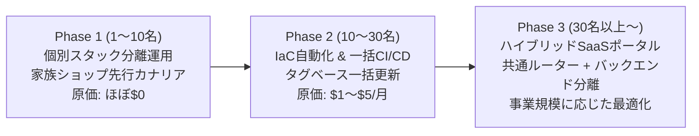
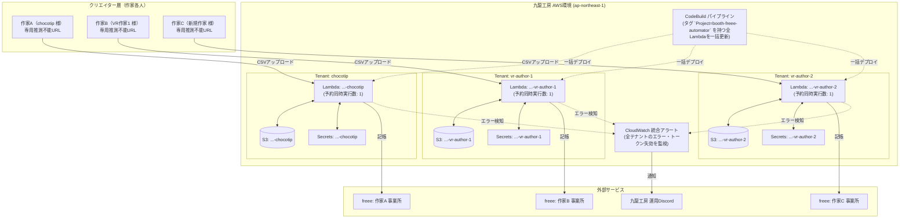

# 九龍工房 マルチテナント提供アーキテクチャ＆運用設計書
**― クリエイター向け「BOOTH $\rightarrow$ freee 自動記帳サービス」スケーラブル展開計画 ―**

---

## 1. 背景と設計方針

### 1.1 背景
現在、`booth-freee-automator` は単一クライアント（chocotip 様）向けに本番稼働（v1.6.1）しています。  
今後、複数のVRクリエイター、同人作家、個人事業主へと利用者を拡大するにあたり、九龍工房として「開発・運用コストを最小化しつつ、安全かつ持続可能にサービス提供する」ためのアーキテクチャを定義します。

### 1.2 コア設計原則
1. **税務・個人情報の完全隔離 (Zero Data Leakage):**  
   クリエイターごとに売上・取引先・口座情報が厳密に異なるため、顧客間のデータ混同・誤記帳は事業上の致命的インシデントとなります。
2. **クリエイターのUX最優先 (Capability URL 方式の維持):**  
   ITリテラシーが多様な作家に対して複雑なログイン認証を課さず、推測不能な個別URLによるワンアクション・ドラッグ＆ドロップ運用を徹底します。
3. **低固定費・AWS無料枠の最大活用:**  
   Lambda・S3の従量課金特性を活かし、顧客が増えても固定サーバー代が発生しないサーバーレス設計を維持します。
4. **一括保守性の確保 (Single Source of Truth):**  
   freee APIやBOOTH CSVの仕様変更が発生した際、全顧客のシステムを最小工数で一括アップデートできるCI/CDパイプラインを確立します。

---

## 2. スケーリングフェーズ設計

利用規模の成長に合わせて、段階的にアーキテクチャを進化させます。



| フェーズ | 規模 | アーキテクチャ | 払い出し方法 | アップデート方式 | 月額インフラ原価目安 |
| :--- | :--- | :--- | :--- | :--- | :--- |
| **Phase 1** | 1〜10名 | 個別スタック分離 (S3+Lambda+Secret) | 手順書に基づく半自動スクリプト | CodeBuild スクリプトによる一括更新 | ほぼ \$0 (無料枠内) |
| **Phase 2** | 10〜30名 | IaC (AWS SAM / Terraform) 統合 | ワンコマンド自動プロビジョニング | CodeBuild + タグ検索による全自動反映 | \$1〜\$5 /月 (Secrets保管費等) |
| **Phase 3** | 30名以上 | 共通ポータル + 分離バックエンド | 管理画面からの自動テナント追加 | 共通コンテナ / レイヤー更新 | 個別算定 (事業規模に応じた最適化) |

---

## 3. インフラ・アーキテクチャ詳細

### 3.1 テナント分離モデルの比較

| 項目 | モデルA: 完全個別スタック型（採用） | モデルB: 単一Lambda共有マルチテナント型 |
| :--- | :--- | :--- |
| **構成** | 作家ごとに `S3`, `Lambda`, `SecretsManager` を個別配置 | 1つの巨大Lambdaが全作家の処理を共通実行 |
| **誤爆・混同リスク** | **構造的にゼロ（物理分離）** | 高い（バグによるクロスデータ記帳リスク） |
| **トークン競合** | なし（同時実行数1を個別設定） | 激しい（他人の処理中に自分のトークン失効リスク） |
| **爆風半径** | 1人のエラー・トークン切れは他人に波及しない | 1人のレートリミット超過で全員停止 |
| **保守の手間** | 更新時に全関数のデプロイが必要 | デプロイは1回で済む |
| **判定** | **Phase 1〜2において圧倒的に優位（採用）** | 将来のWebポータル統合時（Phase 3）に再検討 |

### 3.2 Phase 1〜2 の推奨システム構成



---

## 4. 運用・CI/CD・保守戦略

### 4.1 全テナント一括デプロイの自動化 (`buildspec.yml`)
顧客が増えた際、1つずつ手動デプロイする手間を排除するため、CodeBuild側でAWSリソースタグを利用した**一括デプロイロジック**を導入します。

* **リソース命名・タグ規約:**
  * Lambda関数名: `booth-freee-automator-<client_id>`
  * リソースタグ: `Project=booth-freee-automator`, `Environment=production`
* **デプロイコマンド例 (`buildspec.yml` の `post_build`):**
  ```bash
  # Project=booth-freee-automator タグを持つ全本番Lambdaを動的取得して順次更新
  FUNCTIONS=$(aws resourcegroupstaggingapi get-resources \
    --tag-filters Key=Project,Values=booth-freee-automator Key=Environment,Values=production \
    --resource-type-filters lambda:function \
    --query "ResourceTagMappingList[*].ResourceARN" --output text | awk -F: '{print $NF}')

  for fn in $FUNCTIONS; do
    echo "Updating Lambda: $fn ..."
    aws lambda update-function-code --function-name "$fn" --zip-file fileb://deployment.zip
    aws lambda wait function-updated --function-name "$fn"
  done
  ```
  これにより、作家が10人・20人に増えても、GitHubの `main` にマージするだけで**全員の環境が漏れなく全自動で最新バージョン（例: v1.6.1）に更新**されます。

### 4.2 トークン失効・エラー監視の一元化
* **課題:** freee APIのリフレッシュトークンは最大90日（または定期無効化）で切れる。作家が月末にCSVを投入した際に失敗して初めて気づくのを防ぎたい。
* **対策:**
  1. **ログ監視:** Lambdaログ内の `[ERROR]` や `HTTP 401 Unauthorized` を CloudWatch Metric Filter で検知。
  2. **Webhook通知:** CloudWatch Alarm $\rightarrow$ SNS $\rightarrow$ 九龍工房の Discord チャンネル（`#alert-booth-freee`）へ通知。
  3. **プロアクティブな定期死活監視（オプショナル）:** 月初に全テナントのトークン有効性を確認する軽量cron Lambdaを配備（トークンが切れていた場合は月末前に九龍工房から作家へ事前連絡）。

---

## 5. 事業モデルと提供形態の設計

九龍工房として提供する際のパッケージ構成案：

### プランA: 「安心おまかせマネージド運用プラン」（推奨・主力）
* **対象:** IT設定を一切したくない作家様
* **形態:** 九龍工房のAWSインフラ上で環境を代理ホスティング
* **料金体系:** 初期導入費（初回面談・freeeプライベートアプリ開設支援） ＋ 月額保守料（例: 500〜1,000円/月）
* **提供物:**
  * 作家専用のWebアップロードポータルURL（ブックマークして毎月ドラッグ＆ドロップするだけ）
  * freee API仕様変更・BOOTH仕様変更時の完全無償自動アップデート
  * トークン失効時の再連携サポート

### プランB: 「買い切りセルフホストプラン」
* **対象:** 自身のAWSアカウントで動かしたいエンジニア気質の作家様
* **形態:** 作家のAWS環境にCloudFormationまたは手順書で一式デプロイ
* **料金体系:** 買い切りサポート費（例: 10,000〜20,000円）
* **保守:** GitHubのReleases（`deployment.zip`）を参照してセルフアップデート

---

## 6. 実務運用・サービス設計における合意方針
1. **完全SaaS型マネージド提供モデル:**  
   作家など顧客にAWSリソースやIAMを触らせることは一切ありません。AWSインフラは九龍工房が一元管理・保守し、作家には推測不能な専用アップロードURLのみを払い出します。
2. **税区分（課税10%）と勘定科目:**  
   freeeを利用する作家は青色申告（複式簿記）が前提であり、免税事業者（売上1000万円以下）であっても初期設定の「課税売上10%」で問題ありません（freee側で免税・簡易課税・2割特例に応じた決算集計が可能）。
3. **AWS Secrets Manager の原価算入:**  
   九龍工房の副業事業における通信費・サーバー代として明確に経費算入できるため、セキュリティとトークン更新の信頼性に優れたSecrets Managerを継続採用します。
4. **カナリア展開モデル:**  
   テスト用Lambda（`-test`）および先行運用中の家族ショップ環境（chocotip 様）をカナリア環境として運用し、一般顧客向けLambdaへの一括デプロイ前に実環境ドッグフーディングを実施します。

---

## 7. 今後の実装TODO
1. **テナント自動プロビジョニングスクリプトの作成 (`tools/provision-client.ps1`)**
   - 作家ID、freeeシークレットJSONを引数に取り、S3・Lambda・Secrets Manager・Function URL・タグ設定を2分で自動構築するスクリプトの作成。
2. **CodeBuild のタグベース一括デプロイ対応**
   - 複数Lambdaを検出してループ更新するCI/CDへの拡張。
3. **エラー監視Discord通知の共通SNSトピック設定**

